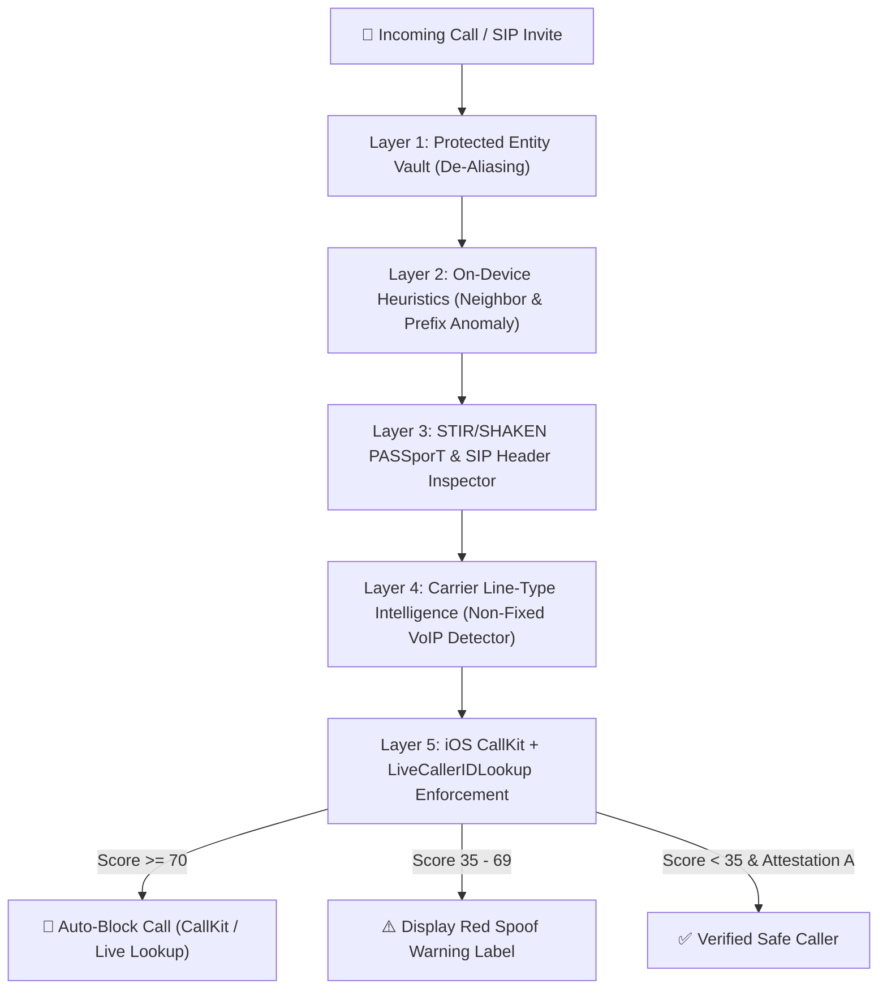

# 🛡️ CLI Spoof Shield — Device-Side VoIP & CLI Spoofing Defense

A hybrid **iOS Device-Side Defense Suite (`CallDirectoryExtension` + `LiveCallerIDLookup`)** and **Interactive PIR / CallKit Verification Workbench** designed to detect, label, and block spoofed Calling Line Identification (CLI) and rogue Non-Fixed VoIP calls before the user answers.

---

## 🚀 Quick Start (Interactive Workbench & PIR Server)

Requires **Node.js 22+** (uses built-in `node:sqlite` with zero external npm dependencies):

```bash
npm start
# Or directly:
node server.js
```

Open **`http://localhost:4150`** in your browser to test the 5-layer CLI/VoIP spoofing engine, simulate incoming spoofed calls on the interactive iOS CallKit screen, inspect the compiled `CXCallDirectoryPhoneNumber` ascending `Int64` table, and configure optional **Twilio Lookup v2** or **Numverify** API keys in the **⚙️ Setup Assistant**.

---

## 📂 Repository Structure

- **`ios-app/`** — Native iOS Swift Package & Extensions (`CLISpoofShieldKit`)
  - `Shared/CLISpoofEngine.swift` — 5-Layer Risk Scoring Engine:
    1. **Layer 1: Protected Entity Vault (De-Aliasing)** — Prevents outbound-only bank/government customer service numbers from being trusted when spoofed inbound.
    2. **Layer 2: On-Device Heuristics** — Detects `NPA-NXX` Neighbor Spoofing, self-spoofing, and unallocatable NANP exchanges (`555-01XX`, leading `0/1`) + generates the 10,000-number `NPA-NXX` CallKit shield.
    3. **Layer 3: STIR/SHAKEN PASSporT & SIP Header Inspection** — Evaluates Attestation Tiers (`A`, `B`, `C`, `NONE`, `FAILED`), `RFC 8225` PASSporT `orig.tn` claims, replay freshness (`iat`), and `From` vs. `P-Asserted-Identity` header mismatches.
    4. **Layer 4: Carrier Line-Type Intelligence** — Classifies `nonFixedVoip` (burner/wholesale SIP trunks), `fixedVoip`, `tollFree`, `mobile`, and `landline`.
    5. **Layer 5: CallKit & LiveCallerIDLookup Enforcement** — Produces deterministic `BLOCK`, `WARN_LABEL`, or `ALLOW` actions.
  - `Shared/SQLiteStore.swift` — App Group C-API `sqlite3` persistence for sorted `Int64` CallKit rules and call logs.
  - `Shared/CarrierLookupService.swift` — Live **Twilio Lookup v2** & **Numverify** client with automatic **Local Offline Heuristic Fallback**.
  - `CallDirectoryExtension/CallDirectoryHandler.swift` — Production `CXCallDirectoryProvider` implementation.
  - `LiveLookupExtension/LiveCallerIDLookupExtension.swift` — iOS `IdentityLookup` (`LiveCallerIDLookup`) configuration for Oblivious HTTP / PIR real-time lookup.
  - `CompanionApp/ContentView.swift` — SwiftUI Companion App with policy toggles, diagnostic call tester, and **⚙️ Setup Assistant Sheet**.
- **`server.js`** — Zero-dependency Node.js PIR Lookup Server & Simulation API (`node:sqlite` + JSON store).
- **`public/index.html`** — Interactive iOS CallKit Lock-Screen Simulator & Policy Workbench.

---

## 🔬 Architecture & 5-Layer Detection Pipeline


