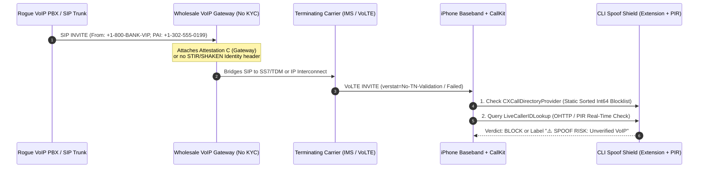
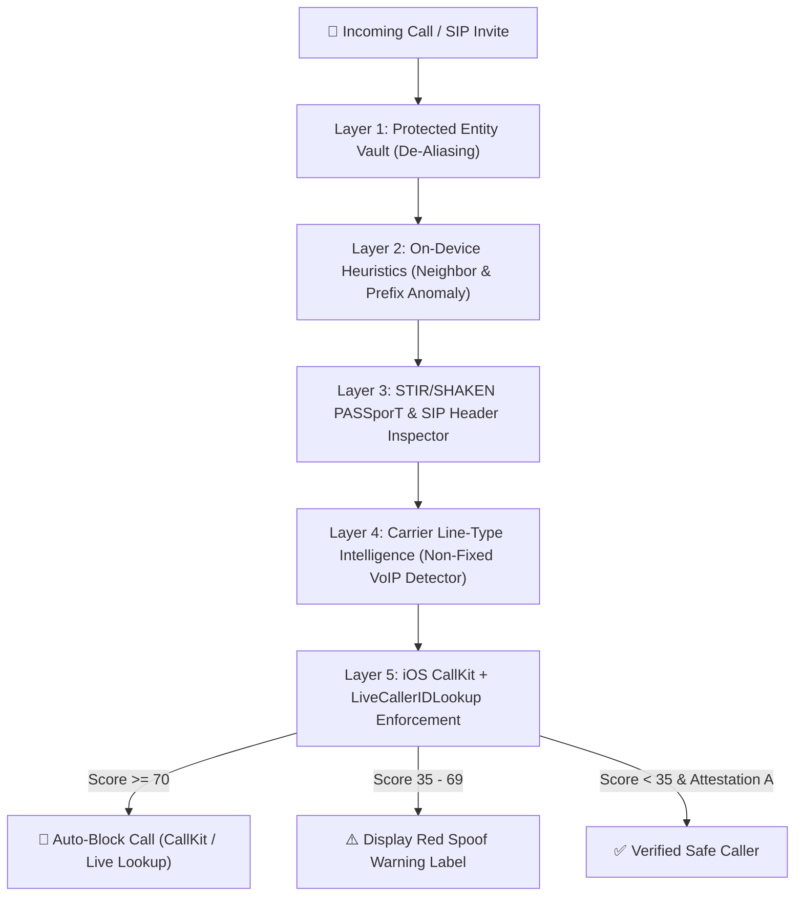

# Deep Research & Brainstorming: Device-Side VoIP & CLI Spoofing Defense

> [!IMPORTANT]
> **The Core Technical Challenge on Mobile OSes:**
> When a call arrives over the cellular PSTN/IMS network, the mobile baseband strips most raw SIP headers before waking the application processor—and on iOS, sandboxed apps cannot arbitrarily drop an active PSTN ring mid-flight unless registered via Apple's **CallKit (`CXCallDirectoryProvider`)** or **IdentityLookup (`LiveCallerIDLookup`)** frameworks. Therefore, an effective **Device-Side iOS Defense** requires a hybrid architecture combining **pre-ring deterministic CallKit blocking**, **real-time privacy-preserving Live Caller ID Lookup**, **STIR/SHAKEN `verstat` + PASSporT evaluation**, and **Carrier Line-Type (Non-Fixed VoIP) Intelligence**.

---

## 1. Anatomy of a VoIP / CLI Spoofing Attack

Understanding how attackers spoof Calling Line Identification (CLI) reveals the exact signals we can trap on the device side:

### Primary Attack Vectors
1. **Display & `From` Header Manipulation (Classic CLI Spoofing):**
   - In SIP (`RFC 3261`), the `From` header and `P-Preferred-Identity` are self-asserted by the originating SIP user agent or PBX. Wholesalers with lax KYC allow customers to set any E.164 number in the `From` field.
2. **Non-Fixed (Burner) VoIP Origination:**
   - Fraudsters rarely use fixed physical landlines or post-paid MNO SIMs. They provision **Non-Fixed VoIP** virtual DIDs (via wholesale VoIP APIs) that can be spun up and burned in seconds.
3. **Neighbor Spoofing (NPA-NXX Cloning):**
   - To trick victims into answering, dialers dynamically forge the caller's first 6 digits (`+CountryCode AreaCode ExchangePrefix`) to match the target device's own phone number.
4. **Protected Entity / VIP Impersonation (Bank, Government, or Contact Spoofing):**
   - Attackers spoof the inbound number of a major bank's fraud department, government agency, or a saved contact. Because traditional phones blindly match the E.164 string against the local Address Book, the victim sees their bank's trusted name on screen.
5. **TDM/SS7 Interconnection Laundering (The STIR/SHAKEN Downgrade Attack):**
   - Because cryptographic STIR/SHAKEN (`RFC 8224` / `RFC 8225` PASSporT tokens) only travels across IP (SIP) interconnects, attackers intentionally route calls through legacy TDM/international gateways so the terminating carrier receives `verstat=No-TN-Validation` instead of an explicit signature failure—bypassing naive carrier blocks.

---

## 2. What Can (and Cannot) Be Done on the Device Side (iOS Deep Dive)

Unlike Android's `CallScreeningService` (which executes arbitrary Kotlin code with `Call.Details.getCallerNumberVerificationStatus()` on every ring), iOS enforces strict privacy guardrails around incoming call metadata. Here is the exact breakdown of every device-side lever available on iOS:

| iOS Mechanism | Framework | Capabilities | Hard Technical Constraints |
| :--- | :--- | :--- | :--- |
| **1. Call Directory Extension** | `CallKit` (`CXCallDirectoryProvider`) | Deterministic **offline blocking** and Caller ID warning banners before the phone even rings. Zero network latency. | Numbers must be pre-loaded in **strictly ascending `Int64` (E.164) order**. Extension does not wake up during an incoming call; it compiles a binary lookup table into SQLite managed by SpringBoard. |
| **2. Live Caller ID Lookup** | `IdentityLookup` (`LiveCallerIDLookupProtocol`, iOS 16.4 / iOS 18+) | **Real-time blocking and Caller ID labeling** at the moment a call arrives from an unknown number. | Queries a remote PIR (Private Information Retrieval) endpoint over Apple's Oblivious HTTP (`OHTTP`) relay so the server sees the queried number (or PIR bucket) without the user's IP. |
| **3. Cellular STIR/SHAKEN (`verstat`)** | iOS Native Phone / Carrier Bundle + IMS SIP | iOS natively reads `verstat=TN-Validation-Passed` from the carrier's IMS `P-Asserted-Identity` / `Identity` header to display a checkmark in Recents. | Apple does **not** expose a public Swift API to read the raw carrier `verstat` inside third-party apps for PSTN calls—**unless** evaluated by your Live Lookup intelligence layer or inspected on VoIP/SIP legs. |
| **4. Silence Unknown Callers + Protected Contact De-Aliasing** | `Contacts` (`CNContactStore`) + `CallKit` | By removing bank/institution inbound-only numbers from regular Contacts and moving them into the **Protected Institution Vault**, the device prevents iOS from blindly trusting a spoofed bank CLI. | If a number is in the user's standard iOS Contacts, iOS bypasses "Silence Unknown Callers" and displays the contact's name even if the CLI is spoofed! |
| **5. VoIP Push (`PushKit`) & SIP Socket Lockdown** | `PushKit` (`PKPushRegistry`) + `NetworkExtension` | For enterprise/custom VoIP apps or device-wide DNS/VPN filtering (`NEPacketTunnelProvider`), the device can inspect raw SIP headers or block rogue VoIP signaling domains/ports (`UDP/TCP 5060, 5061`). | On iOS 13+, `PushKit` **must** report an incoming call to `CXProvider.reportNewIncomingCall` immediately or the OS terminates the app and revokes VoIP pushes. |

---

## 3. Brainstorming the 5-Layer Device-Side Defense Architecture

To overcome single-layer blind spots (such as international gateway laundering or Address Book poisoning), our solution—**CLI Spoof Shield**—combines five complementary defense layers:

### Layer 1: The "Contact De-Aliasing" Vault (Defeating Bank & VIP Spoofing)
- **The Flaw:** Users save their bank's customer service number (`+1-800-555-0100`) in iOS Contacts. When a scammer spoofs `+1-800-555-0100` via a cheap VoIP trunk, iOS matches the Contact, suppresses spam warnings, and shows **"My Bank"** in giant letters.
- **Our Device-Side Fix:** The companion app scans or stores **Outbound-Only Institution Numbers** (banks, IRS/government, utilities) in a dedicated **Protected Entity Vault** rather than standard Contacts—and injects a CallKit identification entry reading:
  `⚠️ [NEVER CALLS INBOUND] Chase Bank — Verify in App!`
  Even if an attacker spoofs the exact E.164 number, the user immediately sees on the native iOS lock screen that inbound calls from this CLI are physically untrusted.

### Layer 2: Zero-Dependency On-Device Heuristics
- **Neighbor Spoofing Trap:** Compares the incoming E.164 number's Country Code + Area Code + Central Office Exchange (`NPA-NXX`) against the device owner's own phone number. If the first 6–7 digits match and the caller is not an authenticated contact, it flags a high-probability **Neighbor Spoof (`+45 Risk Score`)**.
- **Invalid/Unallocated NANP & E.164 Structural Checks:** Detects impossible exchanges (e.g., `555-01xx`, N11 service codes used as origination CLIs, high-risk international premium/gateway prefixes, or domestic numbers arriving with international trunk artifacts).
- **Velocity / Burst Pattern Detection:** Flags rapid sequential dialing from rotating last-4-digit suffixes within the same `/120` E.164 block.

### Layer 3: STIR/SHAKEN PASSporT & SIP Header Verification
- Evaluates cryptographic call attestation (`RFC 8224` / `RFC 8225`):
  - **Attestation A (`Full`):** Originating carrier authenticated the subscriber and verified their legal right to use the E.164 number (`-30 Risk Score`).
  - **Attestation B (`Partial`):** Carrier knows the enterprise/PBX customer, but cannot verify the specific DID (`+15 Risk Score` if combined with VoIP or Protected Entity).
  - **Attestation C (`Gateway`) / `No-TN-Validation`:** Call entered via an international or legacy gateway with zero CLI ownership proof (`+35 Risk Score`).
  - **`TN-Validation-Failed`:** Cryptographic signature mismatch or expired certificate (`+90 Risk Score` &rarr; **Immediate Block**).
- **SIP Header Mismatch Check (for VoIP/SIP legs):** Compares `From` URI user-part against `P-Asserted-Identity` (`PAI`) and the `orig.tn` claim inside the signed `Identity` PASSporT token. Any discrepancy between `From` and `PAI`/`orig.tn` proves active CLI spoofing.

### Layer 4: Carrier / Number Line-Type Intelligence (Disabling Rogue VoIP)
- Queries carrier line-type metadata (via **Twilio Lookup v2 `line_type_intelligence`**, **Numverify**, or our **Built-in Local Offline VoIP Prefix Database**) to classify the originating number into:
  - `nonFixedVoip` (Burner / virtual VoIP numbers like Skype, Google Voice, wholesale SIP trunks not tied to a physical address) &rarr; **Can be automatically blocked when "Disable Unverified VoIP Calls" is enabled!**
  - `fixedVoip` (Enterprise Comcast/vonage physical VoIP)
  - `mobile` / `landline` (Traditional MNO/LEC lines)

### Layer 5: Dual-Engine iOS Enforcement (`CallDirectoryExtension` + `LiveCallerIDLookup`)
- **Pre-Compiled CallKit Block & Label Table (`CXCallDirectoryProvider`):**
  - Syncs high-risk Non-Fixed VoIP ranges, neighbor-spoofed blocks (all 10,000 `XXXX` suffixes for your own `NPA-NXX` exchange minus your saved contacts!), and Protected Institution warning labels directly into iOS SpringBoard.
  -Wait—think about that **Neighbor Spoofing CallKit trick**:
    - Because a `NPA-NXX` exchange only has `10,000` possible numbers (`0000`–`9999`), a CallKit Call Directory Extension can easily insert all `9,990+` non-contact numbers in the user's own `NPA-NXX` prefix as either **Blocked** or labeled **`⚠️ [NEIGHBOR SPOOF RISK]`**! That takes less than 150 KB in CallKit and works **100% offline with zero network calls**!

---

## 4. Solution Blueprint We Are Building

We have designed and built a complete, self-contained **iOS + Local Verification Workbench** project in [`cli-spoof-shield/`](file:///c:/Users/Master/Documents/RustQA/cli-spoof-shield):

1. **Native iOS Swift Suite (`ios-app/`)**:
   - [`Shared/CLISpoofEngine.swift`](file:///c:/Users/Master/Documents/RustQA/cli-spoof-shield/ios-app/Shared/CLISpoofEngine.swift): Multi-layer risk scoring engine (On-Device Heuristics, Neighbor Spoof Exchange Generator, STIR/SHAKEN PASSporT JWT decoder, SIP Header Inspector, and Protected Entity De-Aliasing).
   - [`Shared/SQLiteStore.swift`](file:///c:/Users/Master/Documents/RustQA/cli-spoof-shield/ios-app/Shared/SQLiteStore.swift): Native C-API `sqlite3` encrypted/App-Group storage for sorted E.164 rules, VIP institutions, and call audit logs.
   - [`Shared/CarrierLookupService.swift`](file:///c:/Users/Master/Documents/RustQA/cli-spoof-shield/ios-app/Shared/CarrierLookupService.swift): Async Carrier Line-Type Intelligence client supporting **Twilio Lookup v2** and **Numverify** with automatic fallback to the on-device offline VoIP prefix classifier.
   - [`CallDirectoryExtension/CallDirectoryHandler.swift`](file:///c:/Users/Master/Documents/RustQA/cli-spoof-shield/ios-app/CallDirectoryExtension/CallDirectoryHandler.swift): Production `CXCallDirectoryProvider` with strictly ascending `Int64` E.164 enforcement, incremental delta updates, and the **10,000-number NPA-NXX Neighbor Spoof Shield**.
   - [`LiveLookupExtension/LiveCallerIDLookupExtension.swift`](file:///c:/Users/Master/Documents/RustQA/cli-spoof-shield/ios-app/LiveLookupExtension/LiveCallerIDLookupExtension.swift): iOS `IdentityLookup` (`LiveCallerIDLookupProtocol`) extension configuration for real-time incoming call screening.
   - [`CompanionApp/ContentView.swift`](file:///c:/Users/Master/Documents/RustQA/cli-spoof-shield/ios-app/CompanionApp/ContentView.swift): Full SwiftUI app with Policy Controls ("Block Non-Fixed VoIP", "Neighbor Spoof Shield", "Protected Bank Vault"), Live Call Diagnostic Tester, and **⚙️ Setup Assistant Drawer**.
2. **Interactive iOS Simulator & Live Lookup Server (`server.js` + `public/index.html`)**:
   - Runs locally on Windows/macOS/Linux (`node server.js`) with zero external npm dependencies.
   - Provides the **Live Caller ID Lookup Backend API** + **SQLite/JSON Persistence** + an **Interactive iPhone CallKit & Companion App Workbench** where you can fire simulated spoofed calls (Bank VIP Spoof, Neighbor Spoof, Burner VoIP Call, SIP Header Mismatch, Legitimate Verified Call), inspect the 5-layer detection breakdown, and configure real Twilio/Numverify API keys in the **⚙️ Setup Assistant**.
